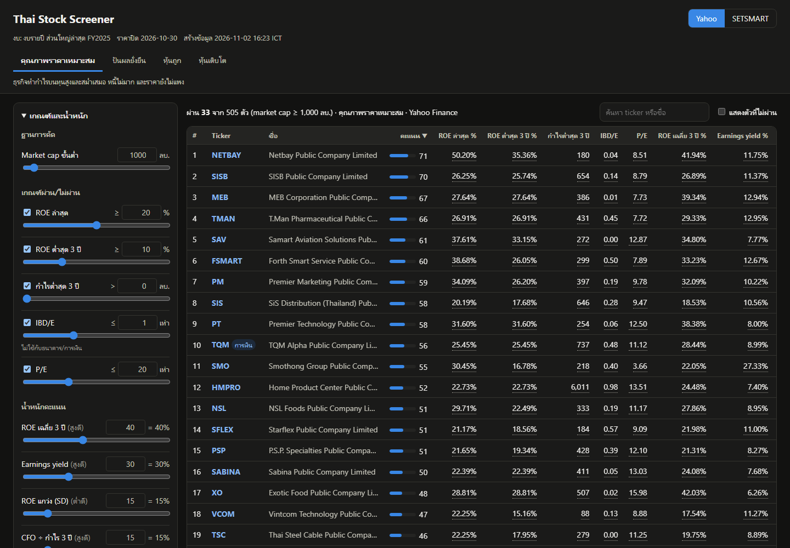
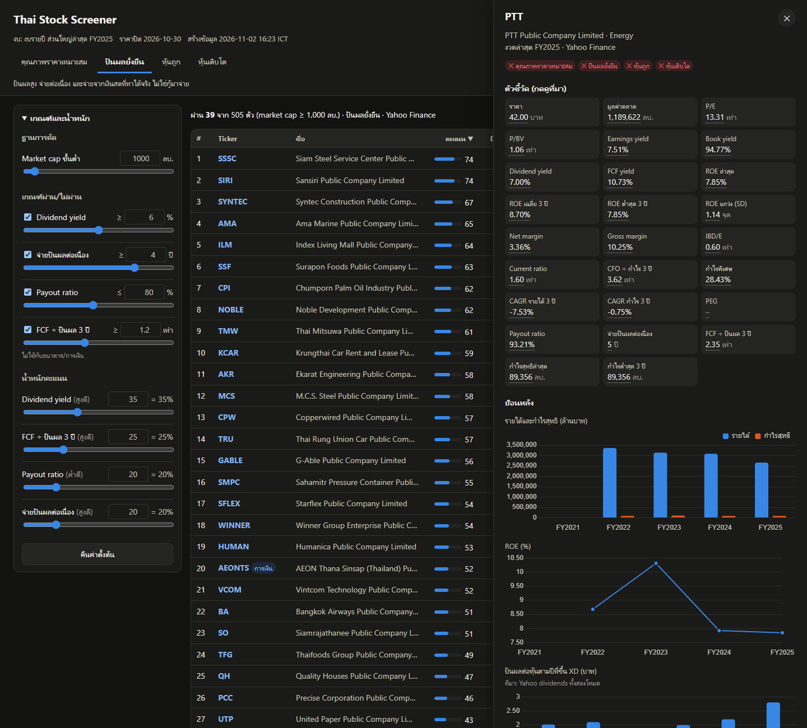

# output/

ผลงาน: **Thai Stock Screener 4 มุมมอง** — dashboard หน้าเดียว ไม่ต้องติดตั้งอะไร

## ลิงก์ผลงาน

- เปิดใช้งาน: https://punlertmail-stack.github.io/aia-hw-arm/output/
- ลิงก์ตรงไปหุ้นตัวหนึ่ง: `…/output/?src=setsmart&preset=dividend&t=PTT` (`src` = yahoo / setsmart · `preset` = quality / dividend / value / growth · `t` = ticker)

## ภาพหน้าจอ

| หน้าหลัก (preset คุณภาพราคาเหมาะสม · Yahoo) | หน้ารายตัว (PTT · preset ปันผลยั่งยืน) |
|---|---|
|  |  |

## ไฟล์ในโฟลเดอร์นี้

| ไฟล์ | คืออะไร |
|---|---|
| `index.html` · `app.js` · `style.css` | หน้า dashboard (HTML + JS ธรรมดา กราฟใช้ Chart.js 4.4.1 จาก cdnjs) |
| `data/yahoo.js` | ตัวชี้วัดที่คำนวณจาก Yahoo Finance (สร้างโดย `screener/build.py`) |
| `data/setsmart.js` | ตัวชี้วัดที่คำนวณจาก SETSMART — ไม่มีไฟล์ดิบ รอผู้สอนยืนยัน (`help.md` ข้อ 1) ลบไฟล์นี้ได้ หน้าเว็บยังใช้โหมด Yahoo |
| `data/presets.js` | สำเนาเกณฑ์จาก `presets.json` |

สร้างข้อมูลใหม่: `python screener/build.py` (ต้องมีข้อมูลดิบในเครื่องตาม workspace ของคอร์ส)

ห้ามใส่: ไฟล์ข้อมูลดิบที่ซื้อมา (เช่น SETSMART), บทวิเคราะห์โบรกเกอร์, ข้อมูลพอร์ตจริง
