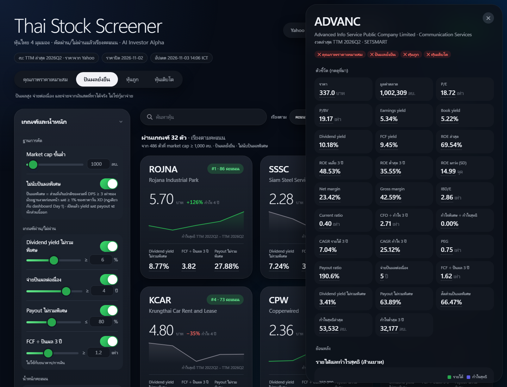

# output/

ผลงาน: **Thai Stock Screener 4 มุมมอง** — dashboard หน้าเดียว ไม่ต้องติดตั้งอะไร

## ลิงก์ผลงาน

- เปิดใช้งาน: https://punlertmail-stack.github.io/aia-hw-arm/output/
- ลิงก์ตรงไปหุ้นตัวหนึ่ง: `…/output/?src=setsmart&preset=dividend&t=PTT` (`src` = yahoo / setsmart · `preset` = quality / dividend / value / growth · `t` = ticker)

## ภาพหน้าจอ

| หน้าหลัก (preset คุณภาพราคาเหมาะสม · Yahoo) | หน้ารายตัว (PTT · preset ปันผลยั่งยืน) |
|---|---|
|  |  |

ผลลัพธ์แสดงเป็นการ์ด (ค่าตั้งต้น) หรือตาราง สลับได้ที่ปุ่ม "การ์ด | ตาราง" · การ์ดมีราคา กราฟเส้นกำไรย้อนหลัง และตัวชี้วัดหลัก 3 ตัวของ preset (กดดูที่มาได้)

โหมดมืด + ปันผลพิเศษ (ADVANC · SETSMART · preset ปันผลยั่งยืน): yield รวมปันผลพิเศษ 10.15% เทียบไม่รวม 3.40% · ในแผงรายตัวมีกราฟ DPS แยกส่วนปกติ/พิเศษ

## ข้อมูลอัปเดตอย่างไร

- **ราคาปิด:** GitHub Actions (`.github/workflows/refresh.yml`) รัน `screener/refresh.py` ทุกวันทำการ 18:30 น. แล้ว commit ไฟล์ใน `data/`
- **งบการเงิน:** เจ้าของ repo เปิด [Actions → อัปเดตราคาและงบ](https://github.com/punlertmail-stack/aia-hw-arm/actions/workflows/refresh.yml) กด Run workflow แล้วติ๊ก statements
- **ปุ่ม "อัปเดตข้อมูล" บนหน้าเว็บ:** โหลดไฟล์ข้อมูลล่าสุดแบบไม่ใช้แคช และบอกวันที่ราคาปิด/งบ (หน้าเว็บดึงจาก Yahoo เองไม่ได้ เพราะ Yahoo ไม่ให้เว็บอื่นเรียกตรง)

## ไฟล์ในโฟลเดอร์นี้

| ไฟล์ | คืออะไร |
|---|---|
| `index.html` · `app.js` · `style.css` | หน้า dashboard (HTML + JS ธรรมดา กราฟใช้ Chart.js 4.4.1 จาก cdnjs) |
| `data/yahoo.js` | ตัวชี้วัดที่คำนวณจาก Yahoo Finance (สร้างโดย `screener/build.py`) |
| `data/setsmart.js` | ตัวชี้วัดที่คำนวณจาก SETSMART — ไม่มีไฟล์ดิบ รอผู้สอนยืนยัน (`help.md` ข้อ 1) ลบไฟล์นี้ได้ หน้าเว็บยังใช้โหมด Yahoo |
| `data/presets.js` | สำเนาเกณฑ์จาก `presets.json` |

สร้างข้อมูลใหม่: `python screener/build.py` (ต้องมีข้อมูลดิบในเครื่องตาม workspace ของคอร์ส)

ห้ามใส่: ไฟล์ข้อมูลดิบที่ซื้อมา (เช่น SETSMART), บทวิเคราะห์โบรกเกอร์, ข้อมูลพอร์ตจริง
